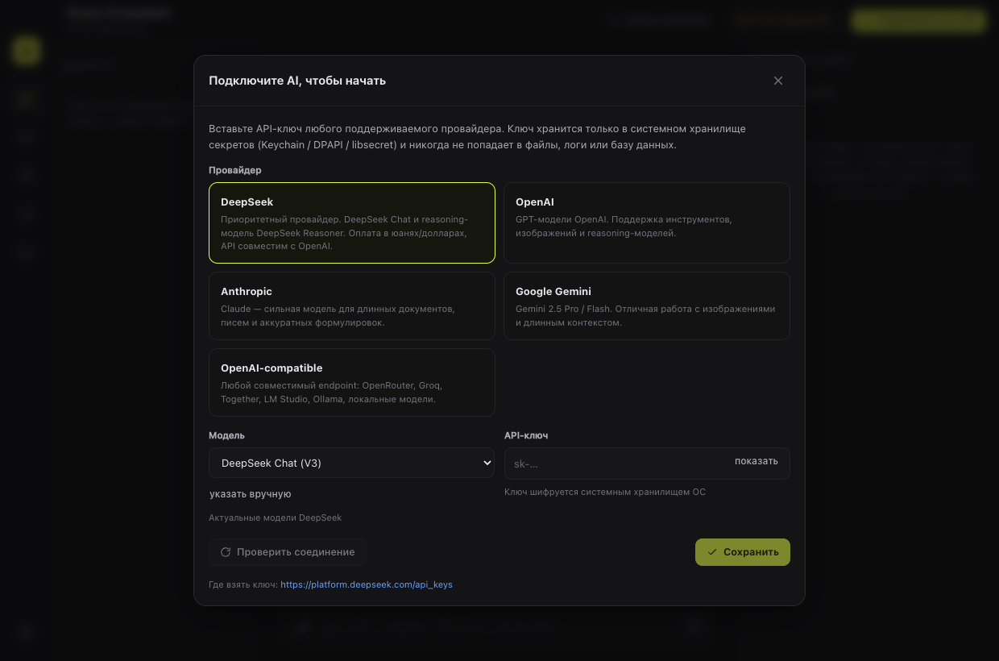
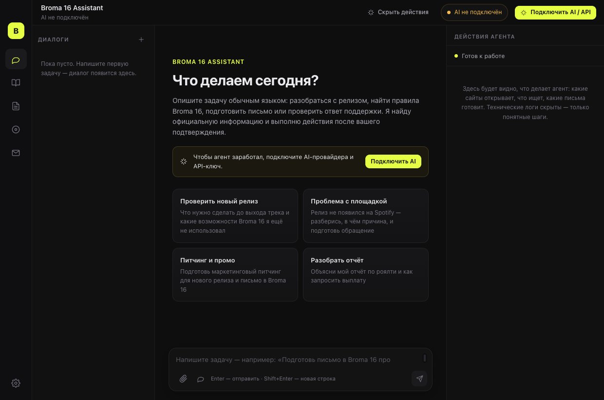

# Broma 16 Assistant


Персональный desktop-ассистент для работы с музыкальным дистрибьютором **Broma 16**: релизы, отчёты, выплаты, питчинг, Content ID, YouTube, тексты песен и поддержка — в одном окне, обычным языком.

Приложение не имитирует работу: письма действительно отправляются, FAQ действительно загружается с официального Help Center, личный кабинет действительно открывается в управляемом браузере.




**Что нового в 1.1.0:** vision-модель для картинок, загрузка обложки/WAV в кабинет и автоматизированный сценарий загрузки релиза.

---

## Что умеет

**AI-агент**
- Один чат: «разберись, почему трек заблокировали на SoundCloud», «подготовь письмо в Broma 16», «сделай план промо на месяц».
- **Зрение через отдельную модель**: если основной чат на DeepSeek (текстовый), обложки и скриншоты автоматически описывает vision-модель (Gemini/OpenAI/Claude/Ollama) — агент видит содержимое картинки и кэширует описание.
- **Загрузка файлов в кабинет**: обложка, WAV, документы прикрепляются в форму релиза через браузерный движок (CDP `DOM.setFileInputFiles`), включая скрытые `input[type=file]`.
- Подключение DeepSeek, OpenAI, Anthropic, Google Gemini и любого OpenAI-совместимого endpoint (OpenRouter, Ollama, LM Studio, Groq).
- Стриминг ответов, вызов инструментов (function calling), анализ изображений мультимодальными моделями.
- Панель действий справа: понятные шаги на русском («Изучаю FAQ Broma 16», «Проверяю данные в кабинете»), источники и тайминги — без технических логов.

**База знаний Broma 16**
- 43 официальные статьи Help Center (Freshdesk) в локальной SQLite, с датой проверки и хешем содержимого.
- Обновление одной кнопкой и автоматически раз в сутки, если данные старше 7 дней.
- Поиск (BM25, поддержка русского и английского), цитаты и ссылки в каждом ответе.
- Отдельная база контактов: `marketing@broma16.com` и `reports@broma16.com` помечены **VERIFIED** (подтверждены официальными статьями), `pr@broma16.com` — **UNVERIFIED**. Несуществующие адреса агент использовать не может.

**Обращения и почта**
- Шаблоны Marketing Pitching, Payment Request, Support Request, Follow-up.
- Создание обращения, история переписки, статусы, привязка ответов по Ticket ID.
- IMAP/SMTP (Gmail, Яндекс, Mail.ru, Outlook, любой сервер) с паролем приложения.
- Синхронизация входящих, определение отдела Broma 16 по адресу и содержанию, уведомления о новых ответах, напоминания о просроченных follow-up.

**Личный кабинет Broma 16**
- Отдельное окно Chromium с постоянной сессией (`africa.broma16.com`).
- Вход, 2FA и CAPTCHA выполняет пользователь — приложение не обходит защиту.
- Чтение страниц, клики, заполнение форм, загрузка файлов, скриншоты — действия с подтверждением.
- Пошаговая загрузка релиза: открыть кабинет → найти форму → проверить поля файлов → заполнить данные → прикрепить обложку и WAV → отправить только после подтверждения.

**Данные и безопасность**
- Локальная SQLite, ничего не уходит на сторонние серверы, кроме запросов к выбранному AI-провайдеру и официальным сайтам.
- API-ключи и пароли почты — только в системном хранилище секретов (macOS Keychain, Windows DPAPI, libsecret). В конфигах, БД и логах их нет.
- Все действия с внешним эффектом показываются карточкой подтверждения: получатель, тема, полный текст.
- `Disconnect Account`, очистка истории и сессии — в настройках.

---

## Установка

**macOS (Apple Silicon):** готовый установщик — в разделе [Releases](https://github.com/smm959/broma16-assistant/releases/latest)
(`Broma.16.Assistant-1.0.0-arm64.dmg`, 128 МБ).

1. Откройте DMG и перетащите приложение в «Программы».
2. Сборка не подписана — при первом запуске разрешите её в «Системные настройки → Конфиденциальность и безопасность» (или правый клик → «Открыть»).

SHA-256: `2c8db964944d04f546b9c84bcfcde6fc81d3a2754ec1ad0af7fa17200bdf2d8c`

**Windows:** установщика пока нет — нужна помощь сообщества, см. раздел ниже.

## Windows: нужна помощь со сборкой

Приложение написано на Electron и работает на Windows 10/11 (x64), но готовый установщик
пока не собран: у автора нет Windows-машины. Если можете помочь — это займёт около 10 минут.

```powershell
git clone https://github.com/smm959/broma16-assistant.git
cd broma16-assistant
npm install
npm run dist:win        # NSIS-установщик + portable .exe появятся в release/
```

Требования: Node.js 22+, Windows 10/11 x64, свободные ~2 ГБ. Подпись не нужна.

Что стоит проверить перед отправкой:
- установщик ставится и приложение запускается из меню «Пуск»;
- ключ API сохраняется (на Windows используется DPAPI) и переживает перезапуск;
- трей и сворачивание окна работают, агент продолжает задачу в фоне;
- IMAP/SMTP подключается;
- `npm run typecheck` и `npm run smoke` проходят (smoke-тест использует локальные фейковые серверы, реальные ключи не нужны).

Куда прислать результат: приложите `.exe`/`.zip` и краткий отчёт в issue
**[Windows build: нужна помощь со сборкой установщика](https://github.com/smm959/broma16-assistant/issues/1)**
либо откройте PR с артефактами. Мы добавим сборку в Releases и укажем вас в благодарностях.

> English: the app supports Windows, but there is no Windows installer yet. If you can run
> `npm run dist:win` on Windows and share the artifacts in a "Windows build" issue, it would be
> much appreciated.

## Установка для разработки

```bash
npm install
npm run dev          # Vite + Electron с горячей перезагрузкой
```

Или production-сборка:

```bash
npm run build
npm start
```

Требования: Node.js 22+ (проверено на 24), macOS 12+ / Windows 10+.

## Сборка установщика

```bash
npm run dist:mac     # dmg + zip в release/
npm run dist:win     # nsis + portable
```

macOS-сборка без подписи: `CSC_IDENTITY_AUTO_DISCOVERY=false npm run dist:mac`.

## Первый запуск

1. **Подключить AI / API** (кнопка справа сверху). Выберите провайдера, вставьте ключ, нажмите «Проверить соединение», затем «Сохранить».
   - DeepSeek: ключ на [platform.deepseek.com](https://platform.deepseek.com/api_keys), модель `deepseek-chat` или `deepseek-reasoner`.
   - Ключ хранится в Keychain/DPAPI — приложение не покажет его повторно целиком, только подсказку вида `sk-…ab12`.
2. **Профиль** → настройки: имя, лейбл, подпись — они подставляются в письма.
3. **Почта** → подключить ящик (для Gmail нужен пароль приложения при включённой 2FA).
4. **Аккаунт Broma 16** → «Открыть кабинет» и войти вручную. Сессия сохранится.
5. Написать задачу в чат.

## Проверка работоспособности

```bash
npm run typecheck
node scripts/smoke.mjs
```

Smoke-тест запускает Electron, проверяет БД, загрузку FAQ, поиск, контакты, разбор PDF/DOCX/XLSX, SSE-стриминг и сборку tool-call'ов на локальном фейковом OpenAI-совместимом сервере, подтверждение действий агента, реальную отправку письма через локальный SMTP, загрузку файла в `input[type=file]` через CDP и vision-анализ картинки (реальные ключи и почта не нужны). Ожидаемый результат: `30/30 проверок пройдено`.

---

## Архитектура

```
electron/
  main.ts              окно, трей, протокол вложений, жизненный цикл
  preload.ts           contextBridge API (renderer не имеет доступа к Node)
  services.ts          сборка зависимостей, настройки
  ipc.ts               все IPC-каналы
  scheduler.ts         фоновая синхронизация почты, follow-up, FAQ
  db/                  SQLite (встроенный node:sqlite), схема, миграции
  kb/                  краулер Freshdesk, BM25-поиск, контакты
  llm/                 ProviderManager, адаптеры OpenAI/Anthropic/Gemini, SSE
  agent/               промпт, инструменты, оркестратор, подтверждения
  email/               IMAP/SMTP, классификация, связка с обращениями
  browser/             управляемый Chromium для кабинета Broma 16
  files/               разбор PDF/DOCX/XLSX/CSV/TXT, экспорт
src/                   React + TypeScript UI (чат, FAQ, обращения, релизы, почта, настройки)
shared/                типы и IPC-контракт, общие для main и renderer
resources/faq-seed.json снимок официального Help Center
```

**Ключевые принципы**
- LLM — заменяемый слой: смена провайдера не трогает тулзы, базу знаний и логику.
- Инструменты описаны декларативно (`electron/agent/tools.ts`), риск действия — `safe` или `confirm`; оркестратор сам создаёт карточку подтверждения.
- История диалога, tool-calls и результаты хранятся в SQLite, поэтому задача продолжается после сворачивания окна и перезапуска.
- Все источники в ответе приходят из инструментов (FAQ/письма/кабинет), а не из «фантазии» модели.

## Ограничения

- **Gmail OAuth** пока не реализован: используется IMAP/SMTP с паролем приложения. Официальный OAuth-поток — следующий шаг (нужен собственный Google Cloud client).
- **DeepSeek не умеет смотреть картинки**: для изображений нужна отдельная vision-модель (Gemini, OpenAI, Claude или локальная через Ollama/OpenAI-compatible). Подключается в «Настройки → AI → Анализ изображений».
- **Broma 16 не публикует официальный API**: интеграция с кабинетом — управляемая браузерная автоматизация с ручным входом. Пароль от аккаунта приложение не хранит.
- **FAQ ограничен тем, что опубликовано**: в Help Center 43 статьи в 3 категориях. Если Broma 16 добавит разделы, кнопка «Обновить базу FAQ» подтянет их автоматически.
- **pr@broma16.com не подтверждён** официальными источниками — помечен UNVERIFIED, агент предупредит.
- **Автоматическая отправка писем** намеренно отсутствует: каждое отправление подтверждает пользователь.
- Подпись приложения не настроена (нет сертификатов Apple/Microsoft) — при первом запуске macOS/Windows могут показать предупреждение.

## Troubleshooting

| Симптом | Что делать |
|---|---|
| «Ключ отклонён (401)» | Проверьте, что ключ скопирован целиком и активен; для OpenRouter нужен ключ OpenRouter, а не OpenAI |
| «Недостаточно средств (402)» | Пополните баланс у провайдера |
| «Модель не найдена (404)» | Нажмите «Проверить соединение» — приложение подтянет список моделей |
| Модель не поддерживает инструменты | Агент автоматически повторит запрос без tools и предупредит; выберите модель с поддержкой function calling (например, `deepseek-chat`, `gpt-4.1`, `claude-sonnet-4`) |
| Gmail: «Invalid credentials» | Включите 2FA и создайте «пароль приложения», обычный пароль не подойдёт |
| Кабинет не открывается | Проверьте VPN/регион; вход выполняйте вручную в открытом окне |
| Ключ не сохраняется | Системное хранилище секретов недоступно — на Linux установите libsecret/gnome-keyring |

## Лицензия

MIT. Проект личный; Broma 16 — торговая марка соответствующего правообладателя.
